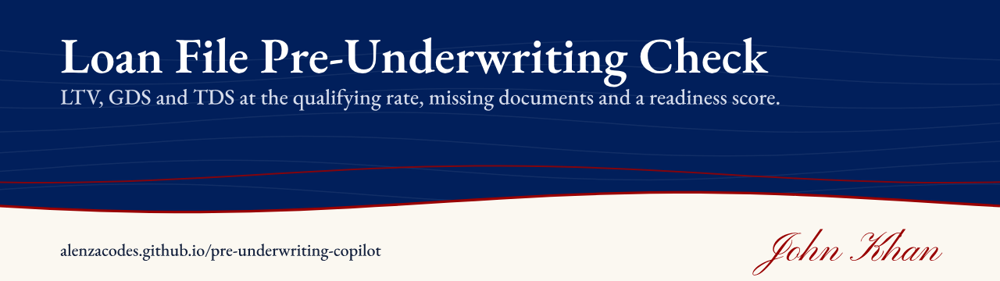
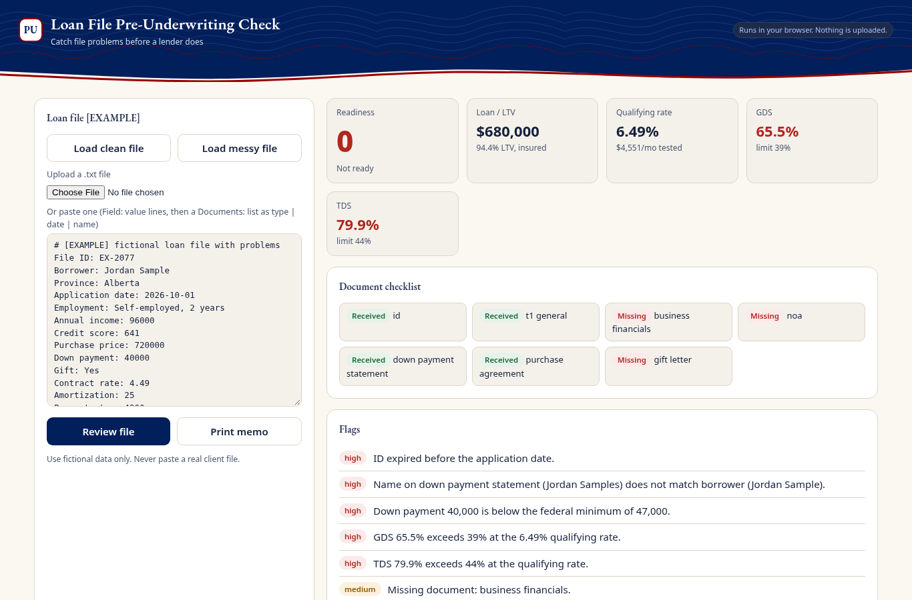
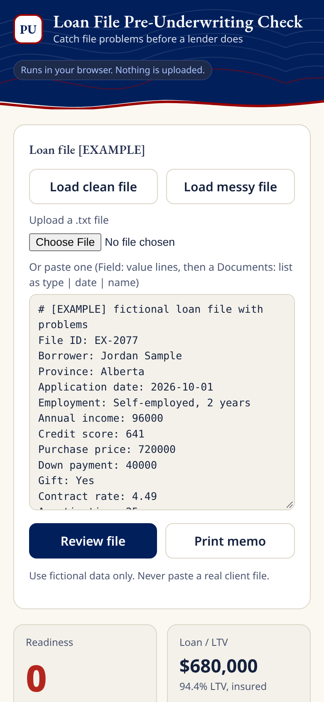

# Loan File Pre-Underwriting Check

**Live:** https://alenzacodes.github.io/pre-underwriting-copilot/

Files get bounced by lenders for avoidable reasons: a stale pay stub, a down payment that doesn't meet the minimum, a TDS that only works at the contract rate. This tool reads a plain-text loan file and catches those before it goes out. It works out LTV, GDS and TDS at the qualifying rate, checks the document list for missing or out-of-date items, gives the file a readiness score and writes a short broker memo.

## Trying it

Load the clean or the messy sample file, or paste your own in `Field: value` lines followed by a `Documents:` list (`type | date | name`). Use fictional data only. Everything runs in the browser and nothing is uploaded.

To run locally, open `index.html` or serve the folder with `python3 -m http.server 8000` and open http://localhost:8000/.

## Rules it checks

- Qualifying rate: the greater of 5.25% or the contract rate plus 2% (OSFI)
- GDS up to 39% and TDS up to 44%, with half of condo fees counted (CMHC)
- Minimum down payment: 5% of the first $500,000, 10% from $500,000 to $1.5M, 20% at $1.5M and above (FCAC)
- Semi-annual compounding on fixed rates (Interest Act)
- Document freshness: 30-day pay stubs and 90-day down payment history. This follows common lender practice and varies by lender.

## Tests

    node tests/test.js

20 checks on the payment math, the file parser, each flag and the readiness score. They run on every push.

## Files

    index.html, style.css   the page
    app.js                  loads a file, shows the review and the memo
    engine.js               parser, ratio maths, document checks and readiness score
    samples.js              the clean and messy example files (fictional)
    tests/test.js           unit tests

## Limits

- Lender overlays differ. A file that passes here can still be declined, and some lenders accept files this tool flags.
- Document freshness rules follow common practice, not a single lender's policy.

## Sources

- Interest Act: https://laws-lois.justice.gc.ca/eng/acts/i-15/page-1.html
- FCAC, down payments: https://www.canada.ca/en/financial-consumer-agency/services/mortgages/down-payment.html
- CMHC insurance cost and ratios: https://www.cmhc-schl.gc.ca/professionals/project-funding-and-mortgage-financing/mortgage-loan-insurance/mortgage-loan-insurance-homeownership-programs/premium-information-for-homeowner-and-small-rental-loans
- OSFI qualifying rate: https://www.osfi-bsif.gc.ca/en/supervision/financial-institutions/banks/minimum-qualifying-rate-uninsured-mortgages

On a phone:

Educational only, not financial advice.

## Licence

MIT. Copyright 2026 John Khan.
